# IPM {#ipm}

An Integrated Population Model(IPM), jointly analyzes data on population size and demographic parameters. Data collected in the field inform the demographic parameters in the model and unifying the analyses of multiple sources of data. Field data in the IPM database may come from the outputs from survival models and sightability models run in the PopR website, analysis done by a specific agencies, and/or agency specific databases. The IPM analyzes populations at the [<b>DAU</b>](#gl-DAU){style="color: #086e04;"} level.

## Walkthrough {#ipm-model}

Using the IPM tool can be split into two major processes: preparing data and reviewing outputs.

### Preparing Data {#ipm-load}

Click on the Setup tab, the first dropdown under the IPM tool menu.

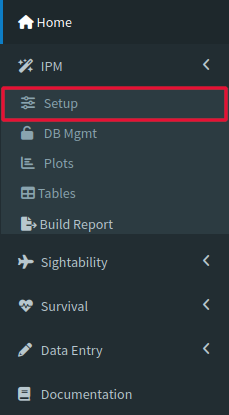

On the top left of the page should be a window labeled Overview, and this is where you determine the data that you run through the IPM. Select the database you want to retrieve the data from, then make sure you choose your [<b>Species</b>](#gl-species){style="color: #086e04;"}, [<b>DAU</b>](#gl-dau){style="color: #086e04;"}, [<b>Unit</b>](#gl-unit){style="color: #086e04;"}, and Weather before you click [<b>Fetch Harvest Data</b>]{style="color: #196eb0;"} on the bottom right of the Overview window to retrieve the specific data you requested.

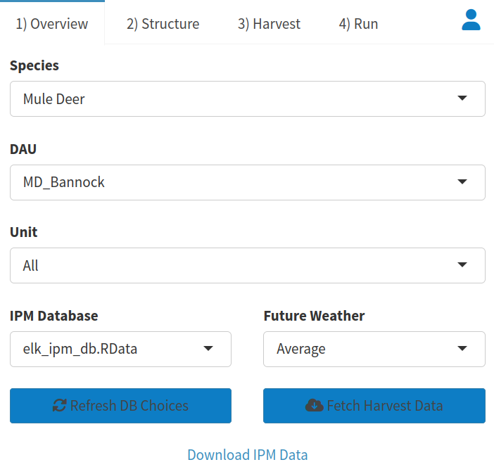

Once the data is loaded, you should get a popup dialog letting you know that the process was successful. It will also prompt you to proceed to the Structure tab.

The Structure tab allows you to select the model structure used in the analysis. For some agencies, the use of population reconstruction or other structural components may be available as structural options. The primary set-up options are to define whether your survival and reproduction will vary annually or be constant. The defaults were chosen to be well-suited to the specific species selected, so most of the time clicking [<b>"Default Structure"</b>]{style="color: #196eb0;"} is a good start for your analysis. The inputs that appear when the tool is opened may not revert to the species specific defaults so clicking on [<b>"Default Structure"</b>]{style="color: #196eb0;"}, will make sure you have selected the defaults before you move on to Harvest.

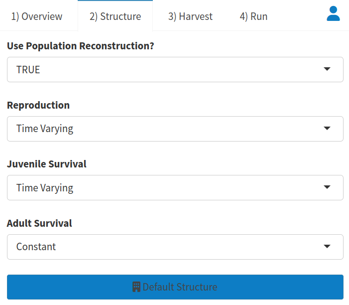

After you select your Structure, you can move on to the Harvest Tab. Decide your effort variable and the years that you will be conducting your analysis, then look at the given information for the years that will be forecast. You can change the Harvest by double clicking the numbers and typing in new entries.

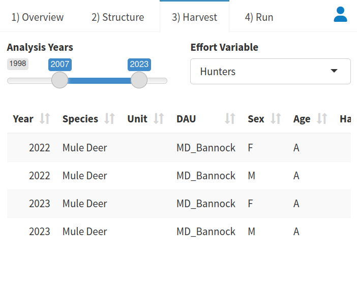

Our next step is the Run tab, which again already has a decent set of default values loaded. Adjust your [<b>Burnin Length</b>](#gl-burnin){style="color: #086e04;"}, [<b>MCMC Iterations</b>](#gl-mcmciter){style="color: #086e04;"}, and [<b>Thinning Rate</b>](#gl-thin){style="color: #086e04;"}. Decide whether you would like to [<b>Automate Convergence</b>](#gl-autoconv){style="color: #086e04;"} (This may increase the time it takes to run the model).

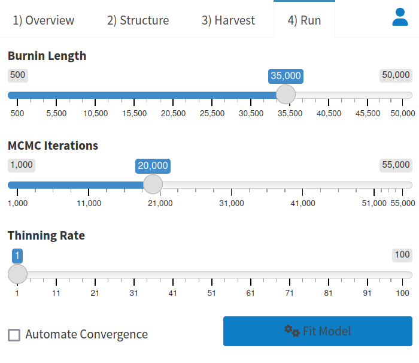

Once you are satisfied with all of the inputs outlined above, click [<b>Fit Model</b>]{style="color: #196eb0;"} to begin analysis. This should take some time, but you will get a dialog box letting you know when the process is complete

### Reviewing Outputs {#ipm-look}

<b>(NOTE: This section will only work if you completed the steps above to prepare your data and fit your model beforehand.</b>)

To look at the model output, wait until the model that you initiated in the setup tab has finished running, then go ahead and click the Plots tab on the IPM dropdown menu to check the results. Hovering your mouse over a point on a plot will give you the parameter, year, age, sex, control limits, and mean associated with the dataset that created the data point. These plots also contain the analogous data from the IPM inputs, so you can compare the model output with the data that was provided as inputs to the model.

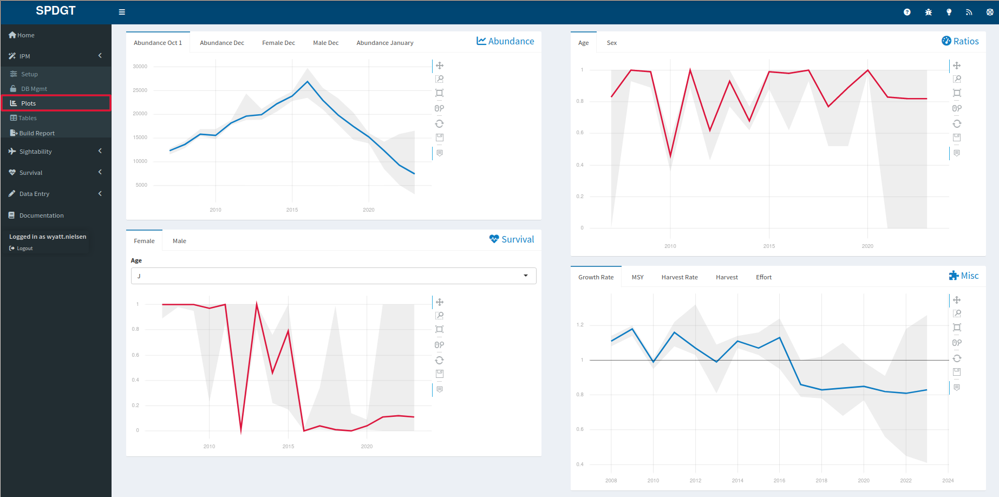

You can also check the model output by clicking the Tables tab right below the Plots one on the IPM dropdown. Rhat values greater than 1.1 are highlighted in red, which means the model may not have converged and should be run again after modifying the settings on the Run tab in the Setup tool. The first ten entries that appear when you open the table tab are not the only outputs of the model. You will notice that you may navigate the pages with the list to the bottom right, or you may increase the number of entries visible at the top left of the page, using the [<b>Show (10) Entries</b>]{style="color: #196eb0;"} dropdown.

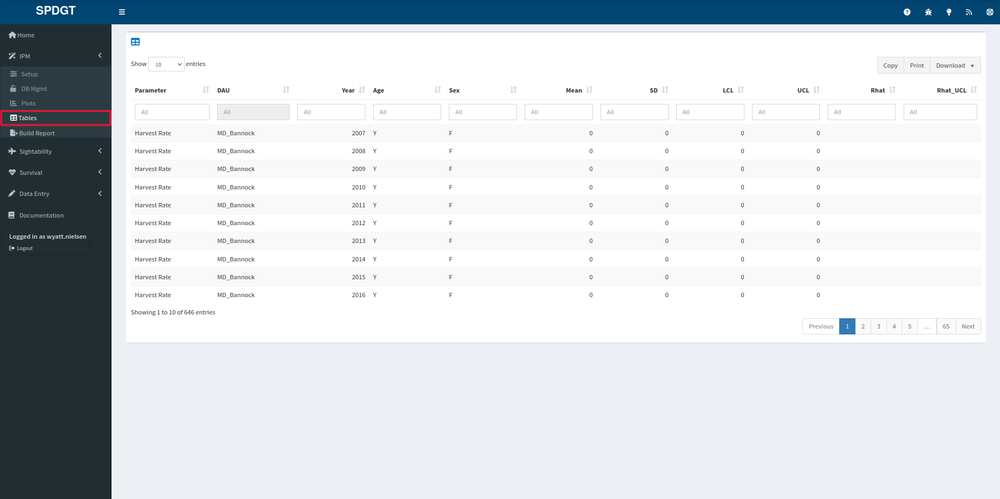

As a final step to get more diagnostic information, use the Build Report tool. 

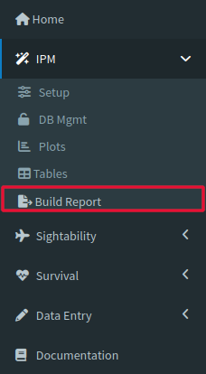

Simply click on the tool and then click the download prompt on the popup window. The resulting document contains interactive plots as well as model specifications and fit.

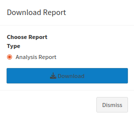

## Saved Runs {#ipm-runs}

A model run can take a long time to fit, and its results are gone when you close the app. Saving a run keeps its setup, the data it was fit to, its results and its report, so you can come back to it, compare it with other runs, share it, or put it forward as your Model Run for Submission without fitting it again. Save run and Open saved run are in the IPM menu.

### Saving a Run {#ipm-save}

Once a model has finished fitting, click [<b>Save run</b>]{style="color: #196eb0;"}. Give the run a name that sets it apart from your other runs, such as the harvest scenario it tests (for example "2027 antlerless harvest cut"), then click [<b>Save</b>]{style="color: #196eb0;"}. The name is how you will find the run later.

Your saved runs are private to you. Other users don't see them unless you share one (see below). Administrators can see every run in your agency's project.

### Opening a Saved Run {#ipm-open}

Click [<b>Open saved run</b>]{style="color: #196eb0;"} to see your saved runs. The list shows the runs for the species and [<b>DAU</b>](05-glossary.html#gl-dau){style="color: #086e04;"} selected on the Setup page; tick <b>Show all runs, not only this species and DAU</b> to see the rest. For each run the list shows:

* <b>Name</b> and <b>Saved</b>: the run's name and when it was saved.
* <b>Species</b>, <b>DAU</b>, <b>Years</b>, <b>Model</b> and <b>Effort</b>: how the run was set up.
* <b>R&#770; < 1.1</b>: how well the model converged (see [Convergence](#ipm-runs-rhat) below).
* <b>Submitted</b>: a &#9733; and the season, when the run is your Model Run for Submission.
* <b>Shared by</b>: who shared the run with you, for a run someone else shared.

Select a run and click [<b>Open</b>]{style="color: #196eb0;"}. Its results appear on the Plots and Tables pages and Build Report builds its report, all as they were when it was saved. Its setup goes back on the Setup page, including the harvest table, so you can change something and fit a new run from it.

To delete runs, select one or more and click [<b>Delete</b>]{style="color: #196eb0;"}. Deleting a run you submitted doesn't withdraw the submission.

### Comparing Runs {#ipm-compare}

The <b>Compare runs</b> page in the IPM menu puts saved runs side by side, for example to compare harvest scenarios. Choose runs for the species and DAU on the Setup page. The page plots the chosen output with one line per run, and a table gives each run's settings and final-year estimates, measured against the first (oldest) run. Only saved runs can be compared, so save a run before comparing it.

### Sharing a Run {#ipm-share}

To give a colleague a copy of a run, select it in Open saved run, click [<b>Share</b>]{style="color: #196eb0;"}, and choose them by name or email. Only people in your agency's project are listed.

They get their own copy in their Open saved run list, marked with your name under Shared by. It's theirs from then on: they can open, change, share or delete it, and nothing they do changes your run.

### Model Run for Submission {#ipm-submit}

When you have the run you want to put forward for a season, mark it as your <b>Model Run for Submission</b>. Select it in Open saved run, click [<b>Submit</b>]{style="color: #196eb0;"}, check the season and click [<b>Submit</b>]{style="color: #196eb0;"}.

* <b>The season</b> defaults to the coming one: the species' model year for today, plus one. A run submitted in November 2026 or January 2027 is for the 2027 season. You can change it before you submit.
* <b>One per species, DAU and season.</b> You have one Model Run for Submission for each species, DAU and season. Submitting another run for the same species, DAU and season replaces your earlier submission, and the dialog tells you which one it replaces. The replaced submission is not kept.
* <b>A submission is a frozen copy.</b> Changing or deleting the run afterwards doesn't change what you submitted.
* <b>To withdraw a submission</b>, select the run, click [<b>Withdraw submission</b>]{style="color: #196eb0;"} and choose the season. The run itself stays in your saved runs.

Your submitted runs show a &#9733; and the season in the Submitted column. Once an administrator locks a season, its submissions can no longer be submitted, replaced or withdrawn; the Submit dialog says when a season is locked.

### Convergence: R&#770; < 1.1 {#ipm-runs-rhat}

The R&#770; < 1.1 column gives the share of the model's estimates whose R&#770; (R-hat) is below 1.1, the convergence measure the IPM analysis reports use. Only years with data are counted; projected years have no data behind them and are left out. The closer to 100%, the better the model converged. A low share means the model may not have converged: run it again with a longer [<b>Burnin Length</b>](05-glossary.html#gl-burnin){style="color: #086e04;"} or more [<b>MCMC Iterations</b>](05-glossary.html#gl-mcmciter){style="color: #086e04;"}, and check the Rhat values on the Tables page.

### Runs From an Older DAU Version {#ipm-dau-version}

DAU boundaries are sometimes redrawn. Each redraw creates a new DAU version, and every DAU in it gets a new identity, even one whose name and number didn't change. The Setup page always lists the current version's DAUs.

A run fit before a redraw is still saved, and the run list shows the version it belongs to, for example "Example Unit 101 (DAU version of 2021-08-31)". Because it no longer matches a current DAU, it's left out of the list for the Setup page's DAU; Open saved run says how many such runs there are, and <b>Show all runs</b> lists them.

You can open such a run to see its results, plots and report as they were saved, but <b>it can't be fit again as it was</b>. The app says so when you open it, and shows a warning on the Plots and Tables pages. Its settings go back on the Setup page, except the DAU: choose a current DAU, and the model will be fit to that DAU's data as it is today.

### For Administrators {#ipm-runs-admin}

Administrators see every user's saved runs in the project, with a <b>Saved by</b> column, and get a [<b>Submissions</b>]{style="color: #196eb0;"} button in Open saved run. It lists every user's Model Run for Submission for a season, by user, species and DAU, with each run's convergence and when it was submitted.

* <b>Open</b> a submission to see its results and build its report, as with any saved run.
* [<b>Lock / unlock season</b>]{style="color: #196eb0;"} stops users from submitting, replacing or withdrawing for that season, once its submissions are final. Administrators can still change them. Click it again to unlock the season.

## Reference {#ipm-ref}

### Setup {#ipm-setup}

The main purpose of the Setup tab is to load and preview data that will be used for later analysis, and we will spend more time describing each element in detail. The window on the top left of the page has several tabs related to data preparation labeled Overview, Structure, Harvest, and Run.

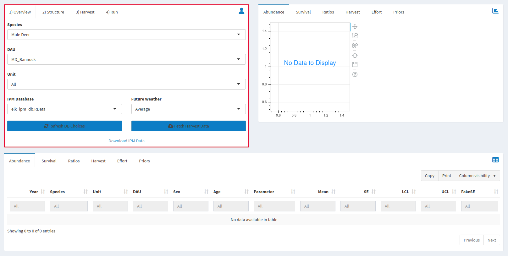

The Overview tab helps you find the data you will be loading for your IPM. Make sure that you are pulling from the correct database! Also, the Future Weather dropdown allows you to consider weather in your IPM analysis. Average assumes mean observed weather conditions, Good assumes upper 95% quantile of observed weather, and Bad assumes lower 5% quantile of observed weather. You may also choose not to include weather in your analysis. All of these values were developed from the dissertation of Mark Hurley.

The Structure tab gives our model some information about assumptions. Population reconstruction is the process of estimating past abundance using a combination of known harvest data and estimated natural mortality rates. If you know when an animal died AND how old it was when it died, then you also know when it was alive. Using this "back-tracking" can create an abundance estimate for past years even if one was not carried out.

The Harvest tab gives our model some important context on harvest metrics. The slider at the top tells our model which years are being analyzed. The effort variable allows us to choose whether effort is determined by the number of days in the field or the number of hunters themselves. It also gives more context to our harvest numbers and helps us tease apart the relationship that hunter effectiveness and raw number of hunters had on the harvest that year. You may also give hypothetical harvest numbers for our model to consider so you may estimate the effects of management decisions on rates like survival and abundance.

The Run tab gives direction to our actual modeling process. The given settings control how we deal with the many thousands of times the model must run to calibrate itself. Adjust your [<b>Burnin Length</b>](#gl-burnin){style="color: #086e04;"}, [<b>MCMC Iterations</b>](#gl-mcmciter){style="color: #086e04;"} and [<b>Thinning Rate</b>](#gl-thin){style="color: #086e04;"}. The bottom of the window gives an option for [<b>Automating Convergence</b>](#gl-autoconv){style="color: #086e04;"} as well. You may adjust any of these factors, but the defaults are appropriate for a wide variety of situations.

The window on the top right of the page is for previewing and exploring the data that will create your analysis. Keep in mind that at this stage you are looking at the model input rather than the output, which is located in Plots and Tables. You can view [<b>Abundance</b>](#gl-abundance){style="color: #086e04;"}, [<b>Survival</b>](#gl-surv){style="color: #086e04;"}, [<b>Sex Ratios</b>](#gl-sexratio){style="color: #086e04;"}, Harvest numbers, and [<b>Hunter Effort</b>](#gl-huntereffort){style="color: #086e04;"}, as well as our Prior distribution for population parameters. A priors distribution gives a range of possible values for each of the factors that are considered by the IPM such as recruitment, survival, and mortality and then the likelihood of each value. This allows the model to consider historical data, but does not give too much power to outlier values. Just because a deer population lost 90% of their population in one year historically does not necessarily mean that it is likely to happen again in future years, but it should not be completely ignored either.

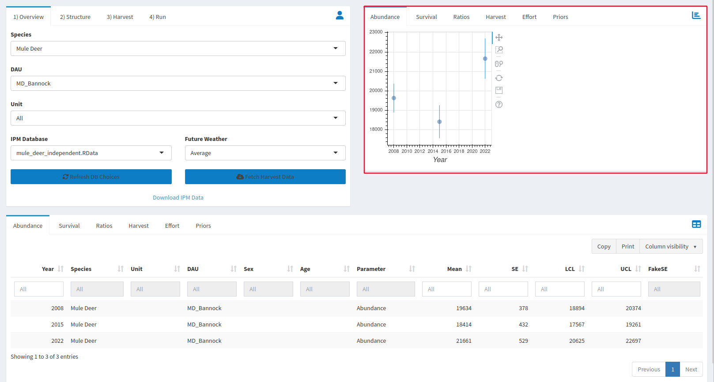

You can explore your graphs in this section with the pan and two zoom features on the side of each graph. Click the reset button to return to the original view. If any of these tabs are blank, it means that the dataset you picked does not have the relevant data to populate it.

The table at the bottom of the page gives another way to preview the data you loaded in the Overview tab. Use the blank column headers to look through your data with their keyword search function. You can page through your data with the previous and next buttons at the bottom of the page.

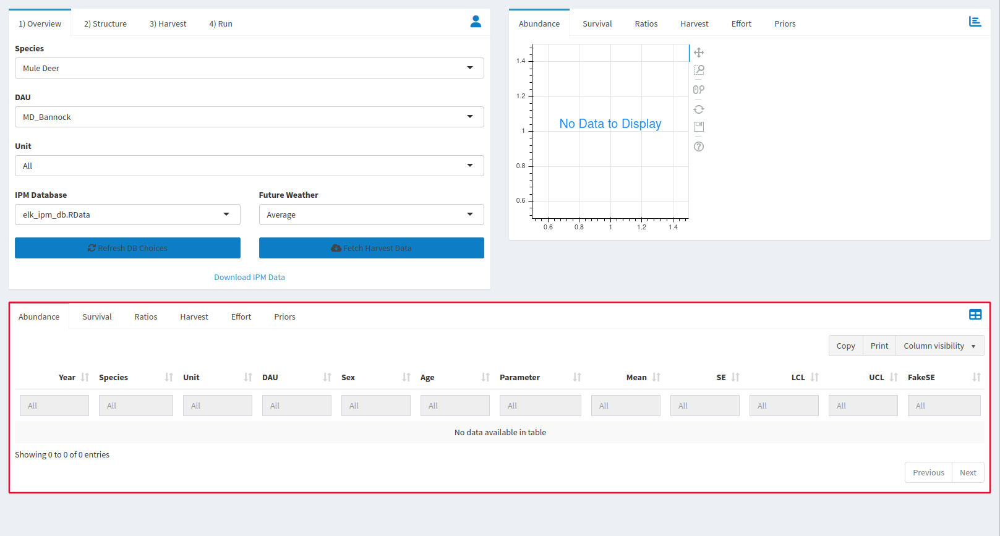

### Plots {#ipm-plot}

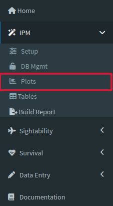

The plots page displays the outputs of the IPM. Use the zoom and pan tools to change your view of the graph, and use the reset button to return to your original view.

Though there are only four windows to display data, each of these windows can be changed by selecting the options across the top. Pictured are the options given for the Abundance window, which allows us to explore [<b>abundance</b>](#gl-abundance){style="color: #086e04;"} during different times of year, as well as separating measurements by sex.

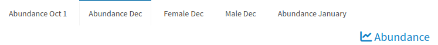

The ratios window allows us to break down the demographics that make up our study population, either by [<b>age</b>](#gl-ageratio){style="color: #086e04;"}.  or [<b>sex</b>](#gl-sexratio){style="color: #086e04;"}. This tab may also contain an age distribution plot that breaks down either proportion of the population or counts of the population by age. This plot is generated based on the expectation that the current population is broken down into ages based on the current survival rate of the specified age and sex class and may not be an accurate representation of the population age structure.

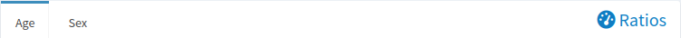

The survival window displays survival through the years for both males and females. Within each sex's tab, you can also select the age group of the animal to compare rates between adults and juveniles.

The Misc window contains many rates that are useful for understanding a population. Growth rate tracks how a population grows as a proportion of the population of the year before. For example, if a population of 100 animals grows by 50 in one year, the growth rate would be 0.5. MSY allows you to select which vital rate will be displayed on your y-axis. Lambda measures growth year by year, recruitment measures population growth, but specifically how many juveniles became adults in a population and how many adults immigrate into a population. Harvest and Harvest rate are often confused, but mean slightly different things. Harvest is the number of animals whose cause of death would be hunter-related, where harvest rate is the proportion of the population that was harvested. Effort measures how hunters put pressure on a population, and is either measured by the number of hunters on the landscape or how many cumulative days that hunters spent in the field. Note: these plots may be customized depending on your agencies needs, so the plots you see may not be the same as the ones pictured here.

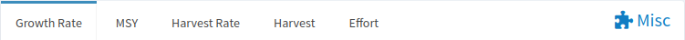

### Tables {#ipm-table}

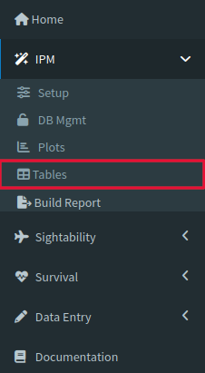

On the Tables page you can download and edit the data you are using for analysis. You can download your data here as well, but note that you will only download the data being displayed to you. By default, the table only shows the first ten entries of your dataset, so if you would like to download your data here make sure you change the dropdown at the top of the window from Show 10 entries to Show All entries.

### Build Report {#ipm-report}

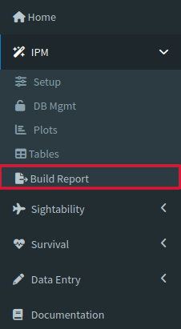

The Build Report tool gives a summary of the analysis conducted, while keeping relevant information like model settings for future comparisons.
